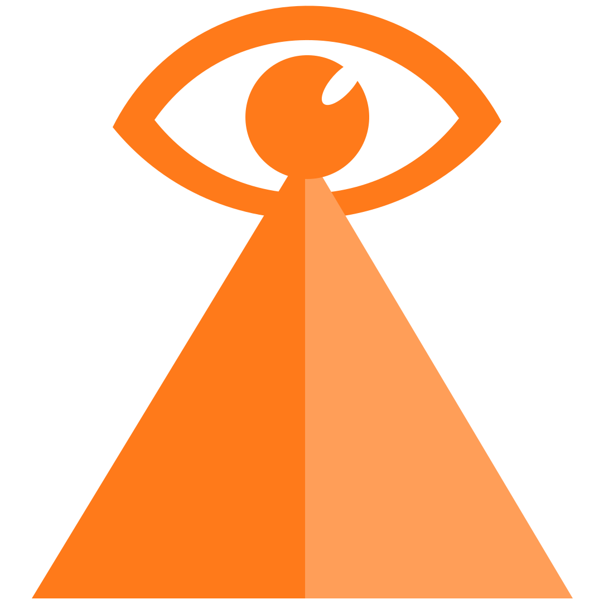

<p align="center">
  
</p>

<h1 align="center">órama</h1>

<p align="center">A self-hosted AI workspace by Doun Industries.</p>

---

órama is a modified version of **[Odysseus](https://github.com/odysseus-dev/odysseus)**,
the open-source AI workspace started by Felix Kjellberg (PewDiePie) and now
maintained by the odysseus-dev community. All the hard work is theirs. This
repo changes the look, trims some features and adds a few of its own.

It's based on Odysseus as of commit
[`8450793`](https://github.com/odysseus-dev/odysseus/commit/8450793), and was
modified by Doun Industries in November 2026.

## What's different from Odysseus

- **Look:** jet black with an orange accent, the órama logo, and "Doun
  Industries" branding in place of Odysseus. Same font.
- **Removed:** Email, Calendar, Gallery and Tasks, including the AI tools that
  go with them.
- **Added:** an Object Detection section (placeholder for now).
- **Fixed:** the ASCII background now fills the whole screen on Linux and
  Windows.
- **Docker:** always builds from this folder, so it can't be swapped for the
  official Odysseus image by mistake.

Everything else (chat with any model, agents, deep research, documents, notes,
memory, skills, running models locally through Cookbook) works as it does in
Odysseus.

The full change list is in [DOUN-SETUP.md](DOUN-SETUP.md), and every change is
in the commit history.

## Install

You need Docker. On Windows or Mac, install Docker Desktop first. Then:

```bash
git clone https://github.com/DounDounJack/Orama.git orama
cd orama
cp .env.example .env
docker compose up -d --build
```

The first build takes 10–20 minutes. Then get your login password:

```bash
docker compose logs odysseus | grep -i password
```

Open http://localhost:7011, log in, and add a model under
**Settings → Add Models** (Anthropic, OpenAI, Google, OpenRouter, or a local
model through Cookbook or Ollama).

More detail, including Windows and Mac notes, is in [DOUN-SETUP.md](DOUN-SETUP.md).

## Credits and licence

- Odysseus by Felix Kjellberg and the odysseus-dev contributors:
  https://github.com/odysseus-dev/odysseus
- Third-party code, fonts and libraries are credited in
  [ACKNOWLEDGMENTS.md](ACKNOWLEDGMENTS.md), with licences in [`licenses/`](licenses/).
- Odysseus's original README is kept in [ODYSSEUS-README.md](ODYSSEUS-README.md).

órama is licensed under the **GNU Affero General Public License v3.0 or later**,
the same as Odysseus. See [LICENSE](LICENSE). If you run a modified version for
other people over a network, the licence requires you to offer them its source
code.
